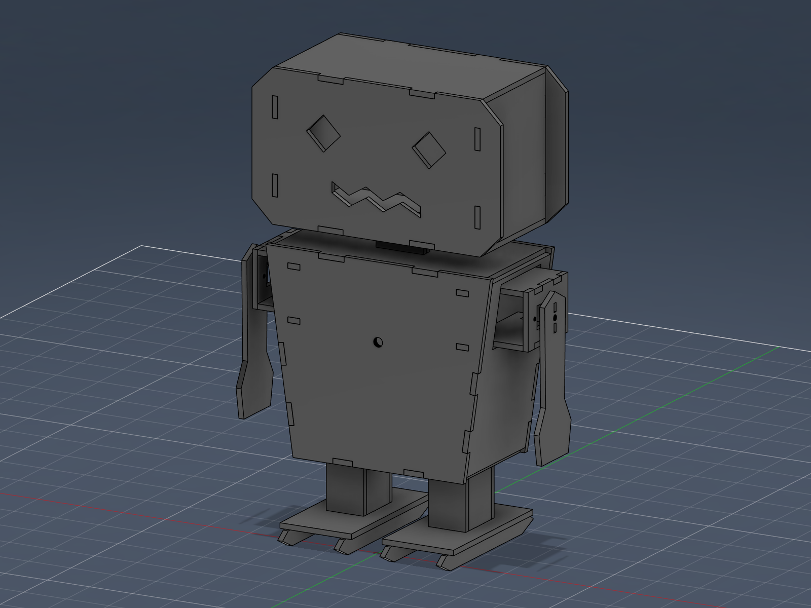
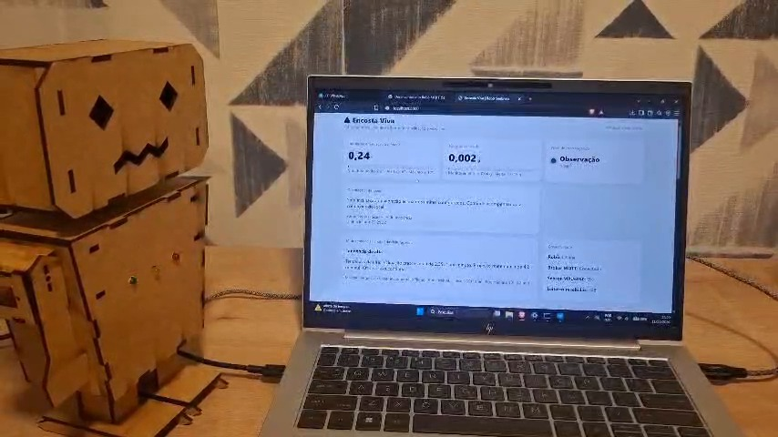

# Encosta Viva — Robô Sentinela

**FIAP · Global Solution 2026.2 · Desafio CitizenTech · Project-Based Maker Lab (Engenharia de Software, 4º ano)**
*Evolução de um robô inteligente para CitizenTech: robô que percebe a inclinação e a vibração de uma encosta, usa IA para antecipar o risco e alerta a comunidade.*

## Equipe

| Integrante | RM |
|---|---|
| Ricardo Matos | 95906 |
| Julio Zampieri | 98772 |
| João Dias | 99092 |

- 🎥 **Vídeo demonstrativo:** [Assistir no YouTube](https://www.youtube.com/watch?v=vArz-0RE7uk)
- 📋 **Ficha técnica do MVP:** [`docs/FICHA_TECNICA.md`](docs/FICHA_TECNICA.md)
- 🧪 **Plano de testes:** [`docs/PLANO_DE_TESTES.md`](docs/PLANO_DE_TESTES.md)

> Sistema demonstrativo (maquete). Não substitui monitoramento geotécnico nem a Defesa Civil (199) e os Bombeiros (193).

## Onde cada critério da MakerLab está atendido

| Critério do professor | Como o projeto atende | Onde ver |
|---|---|---|
| **Funcionalidade do sensor** | MPU6050 (acelerômetro + giroscópio) calibrado na partida; mede inclinação (°) e vibração (g) a 50 Hz. Falha do sensor vira alerta, nunca "tudo verde". | `firmware/`, `hardware/LIGACOES.md` |
| **Implementação da IA** | Regressão linear sobre as leituras reais calcula a taxa de variação (°/min) e projeta o tempo até 10°. Quando prevê subida rápida, o painel destaca **PRÉ-ALERTA**. Opcionalmente um LLM redige a orientação ao cidadão. | `api/ia_encosta.py` |
| **Integração hardware ↔ software** | ESP32 → MQTT → API (regras + IA) → SQLite → dashboard em tempo real; LEDs e buzzer são acionados pelo próprio robô a partir das leituras. | seção "Integração sensor → IA → atuadores" |
| **Adequação ao tema CitizenTech** | Alerta precoce de deslizamentos para moradores de encostas e Defesa Civil (ODS 11 e 13). | seções "Problema" e "ODS" |
| **Autonomia e tomada de decisão** | O robô classifica o risco sozinho em 4 níveis, com histerese, e aciona LEDs e buzzer sem comando manual, mesmo sem Wi-Fi. | tabela de níveis |
| **Acabamento do protótipo** | Estrutura em MDF projetada no Fusion 360 e cortada a laser, com encaixes, tampa USB e guia de montagem (ver "Alterações em relação ao modelo"). | `hardware/fusion360/`, `docs/GUIA_MONTAGEM.md` |
| **Testes e demonstração** | 24 testes automatizados + plano de testes com condições normais e de falha (MPU desconectado, Wi-Fi caído, sem IA). | `docs/PLANO_DE_TESTES.md`, `api/test_*.py` |
| **Criatividade e inovação** | pré-alerta de IA com projeção de tempo, degradação elegante, LLM opcional com fallback, painel acessível em tempo real. | este README |

## Problema (CitizenTech)

Em 19/02/2023, a chuva recorde em São Sebastião (SP) provocou dezenas de deslizamentos e deixou 64 mortos ([Band Vale](https://www.band.com.br/band-vale/noticias/memorias-da-vila-sahy-tres-anos-da-tragedia-de-sao-sebastiao-202602190939)), e a tragédia deixou 2.400 desabrigados ([SBT News](https://sbtnews.sbt.com.br/noticia/brasil/tragedia-de-sao-sebastiao-completa-1-ano-e-ainda-esta-presente-na-vida-dos-moradores)). A Vila Sahy foi o bairro mais atingido, e a prefeitura já conhecia desde 2014 o risco de deslizamento na área ([CartaCapital](https://www.cartacapital.com.br/?p=329600)). O risco era conhecido, mas faltava um aviso local, barato e contínuo para quem mora na encosta.

**Cidadão beneficiado:** morador de encosta de baixa renda e agente da Defesa Civil municipal.
**Solução:** um robô sentinela barato (ESP32 + MPU6050) que vigia a encosta, sinaliza o risco no próprio local (LED e buzzer, sem depender de internet) e publica os dados para um painel online.

## Arquitetura

```text
 MPU6050 (acelerômetro + giroscópio)
        │ I²C
      ESP32 ──── LEDs · buzzer  (alerta local, funciona offline)
        │
  Wi-Fi │ MQTT  encosta/<setor>/leitura
        ▼
   Broker MQTT (HiveMQ)
        │
   API FastAPI ── SQLite ── IA de tendência (regressão linear) ── LLM opcional (Groq)
        │
   Dashboard em tempo real (SSE) · Swagger /docs
```

## Integração sensor → IA → atuadores

1. O ESP32 lê o MPU6050 a 50 Hz, classifica o risco sozinho e aciona LEDs e buzzer. A cada 2 s publica inclinação, vibração e nível por MQTT.
2. A API valida, grava no SQLite e roda a regressão linear sobre as leituras reais dos últimos 90 s.
3. O dashboard mostra a taxa em °/min e a projeção de minutos até 10°. Se a tendência é de alta e a projeção é de até 3 min, destaca **PRÉ-ALERTA** e publica `{"pre_alerta":true,...}` em `encosta/<setor>/ia`.
4. Esse retorno ao robô (LED amarelo piscando e bipe) está implementado no firmware experimental opcional; o firmware principal ignora o tópico.

A IA **nunca altera nem reduz o nível de risco**: o nível vem de regras determinísticas iguais no firmware e na API. A IA só antecipa o aviso no painel (pessoa no circuito: quem decide evacuar é a Defesa Civil).

## Níveis de risco

| Nível | Critério | Indicação no robô |
|---|---|---|
| 0 — Observação | < 3° e < 0,04 g | Verde fixo |
| 1 — Monitoramento | ≥ 3°, ≥ 0,04 g ou falha do MPU | Amarelo fixo + bipe curto |
| 2 — Alerta | ≥ 6° ou ≥ 0,15 g | Vermelho piscando + bipe |
| 3 — Alerta máximo | ≥ 10° | Vermelho piscando rápido + sirene |

Subir de nível é imediato; descer exige 8 s estáveis (histerese). Os limiares são de maquete e precisam de calibração geotécnica antes de uso real.

## Inteligência Artificial (como decide e quais os limites)

- **Modelo:** regressão linear por mínimos quadrados (offline, sem chave, sem internet), recalculada a cada leitura real. Entrada: horário e inclinação; saída: tendência (subindo, estável, caindo), taxa em °/min e minutos até 10°.
- **Explicável:** o painel mostra a taxa, o número de amostras e a projeção, e o modelo é uma reta que qualquer pessoa consegue verificar.
- **Regras de segurança:** exige 5 amostras e 20 s de janela; leituras simuladas e falhas do MPU não treinam o modelo; a IA não muda o nível.
- **Vieses e limites:** assume taxa constante, não conhece chuva nem tipo de solo e só enxerga o ponto onde o sensor está. Por isso a mensagem sempre diz "projeção matemática".
- **LLM opcional (Groq):** com `GROQ_API_KEY` no `.env`, redige a orientação em linguagem simples para o cidadão. Sem chave, internet ou em caso de falha, usa o texto local. A chave nunca vai para o Git.

## Hardware

ESP32 DevKit V1 · MPU6050 · 3 LEDs com resistor de 220 Ω · buzzer ativo · estrutura de MDF 3 mm. (Os 2 servos SG90 previstos no modelo 3D não foram instalados nesta montagem.) Tabela de ligações e cuidados elétricos: [`hardware/LIGACOES.md`](hardware/LIGACOES.md). Montagem: [`docs/GUIA_MONTAGEM.md`](docs/GUIA_MONTAGEM.md). Em `hardware/fusion360/`: script que gera o modelo 3D dentro do Fusion 360, imagem da montagem, DXF das peças para corte a laser e lista das 50 peças.


*Modelo 3D do robô no Fusion 360 (inclui os servos previstos, não instalados na montagem final).*


*Robô físico em operação, ao lado do painel (quadro do vídeo de demonstração: LED verde, nível 0 "Observação").*

## Alterações em relação ao modelo do Fusion 360

O modelo 3D prevê dois servos SG90 (peças `S_E_SUPORTE_SG90` e afins). **Na montagem física final eles não foram instalados**: o robô alerta apenas por LEDs e buzzer, que são os atuadores usados na demonstração. O firmware continua configurando os pinos dos servos (GPIO14 e GPIO13), mas sem servos ligados isso não tem efeito algum e não afeta o funcionamento.

## Como rodar

### 1. Firmware (`firmware/encosta_viva_esp32/encosta_viva_esp32.ino`)
1. Na Arduino IDE, instale **Adafruit MPU6050**, **Adafruit Unified Sensor**, **PubSubClient** e **ESP32Servo** (esta última é necessária para compilar, mesmo sem servos instalados); placa *ESP32 Dev Module*.
2. Preencha `WIFI_SSID` e `WIFI_SENHA` (Wi-Fi 2,4 GHz). **Não commite a senha.**
3. Confira se `SETOR_ID` é igual ao do `.env` da API.
4. Grave e mantenha o robô imóvel por 2 s (calibração). Monitor Serial em 115200 baud.

> Este é o firmware **testado no robô**. Há também uma versão experimental opcional, com pré-alerta da IA no robô e sensor de umidade, em `firmware/experimental_ia_umidade/` (veja o `LEIA.md` de lá). Ela não é necessária para o funcionamento do projeto.

### 2. API e dashboard
```bash
cd api
# Windows: iniciar.bat      Linux/macOS: bash iniciar.sh
# ou manualmente:
pip install -r requirements.txt
python main.py
```
Abra `http://localhost:8000` (dashboard), `/docs` (Swagger) e `/saude` (API e MQTT). A configuração padrão já funciona; copie `.env.example` para `.env` só se quiser mudar algo.

### 3. Testes
```bash
cd api
python -m unittest discover -v     # 24 testes, sem MQTT e sem internet
```
Resultado na última execução (12/11/2026): `Ran 24 tests ... OK`. O plano completo, com os testes no robô e os de falha, está em [`docs/PLANO_DE_TESTES.md`](docs/PLANO_DE_TESTES.md).

## Contrato MQTT

Robô → API, tópico `encosta/vilasahy-q4m8z2/leitura`:
```json
{"setor_id":"vilasahy-q4m8z2","sensor_id":"robo-sentinela-01","inclinacao_graus":4.25,
 "vibracao_g":0.018,"nivel":1,"simulado":false,"mpu_ok":true,"rssi":-60}
```
O campo opcional `umidade_solo_pct` só existe com o firmware experimental e o sensor de umidade ligado; a API aceita leituras com ou sem ele.

API → robô, tópico `encosta/vilasahy-q4m8z2/ia` (não retido; consumido apenas pelo firmware experimental):
```json
{"pre_alerta":true,"status":"subindo","taxa_graus_min":2.4,"previsao_min":1.8}
```

## Endpoints

`GET /` dashboard · `GET /saude` · `GET /api/config` · `GET /api/estado` (leitura, nível e objeto `ia`) · `GET /api/ia/tendencia` · `GET /api/historico` · `GET /api/alertas` · `GET /api/stream` (SSE) · `POST /leituras` · `POST /api/simular/{0..3}` · `GET /docs`.

## Resiliência (funciona fora do cenário ideal)

| Falha | Comportamento |
|---|---|
| Wi-Fi ou broker indisponível | LEDs e buzzer seguem funcionando; o robô reconecta sozinho; o painel mostra "Offline" após 15 s. |
| MPU6050 desconectado | Nível 1 (amarelo) e erro no Serial; nunca fica verde; tenta reconectar a cada 5 s sem recalibrar. |
| API ou IA fora do ar | O robô segue com as regras locais: a decisão de risco é dele, não da IA. |
| Sem internet para o LLM | Orientação local por regras. |
| Banco SQLite antigo | Migração automática da coluna opcional de umidade. |

## Segurança, privacidade (LGPD) e acessibilidade

- **Sem dados pessoais:** o sistema coleta apenas inclinação, vibração e RSSI do Wi-Fi do robô. Não há cadastro, câmera, microfone nem localização de pessoas.
- **Credenciais fora do código:** Groq e MQTT ficam no `.env`, ignorado pelo Git; o firmware vai com `SEU_WIFI` / `SUA_SENHA`.
- **Entrada validada** com Pydantic (faixas de valores) e limite de 500 leituras por lote. O CORS está aberto só para facilitar a demonstração; em produção deve ser restrito.
- **Limitação conhecida:** o broker HiveMQ público não tem autenticação; em produção usar broker privado com TLS e usuário.
- **Acessibilidade:** o nível aparece em texto e cor (não só cor), regiões `aria-live` para leitores de tela, gráfico com descrição, botões nativos navegáveis por teclado e linguagem simples.

## ODS conectados

| ODS | Meta | Como contribui |
|---|---|---|
| **11 — Cidades e comunidades sustentáveis** | 11.5 (reduzir mortes e pessoas afetadas por desastres) e 11.b (resiliência a desastres) | Aviso antecipado e contínuo para moradores de encostas e para a Defesa Civil. |
| **13 — Ação contra a mudança global do clima** | 13.1 (resiliência a riscos climáticos e desastres naturais) | Monitoramento de baixo custo em áreas sujeitas a chuvas extremas, mais frequentes com a mudança do clima. |
| **9 — Indústria, inovação e infraestrutura** | 9.1 (infraestrutura resiliente) | Dispositivo aberto, replicável e barato (ESP32 + MPU6050). |

## Indicadores de impacto

Tempo de antecedência entre o pré-alerta e o nível 3 · número de alertas por mês e taxa de falsos positivos · porcentagem de tempo online · quantidade de encostas monitoradas por real investido · famílias cobertas por sentinela.

## Estrutura do repositório

```text
api/        API FastAPI, IA, dashboard, testes, scripts de execução
firmware/   Código do ESP32 (principal, testado) e versão experimental opcional
hardware/   Ligações elétricas e arquivos do modelo (Fusion 360, DXF, lista de peças)
docs/       Ficha técnica, plano de testes, guia de montagem, roteiro do vídeo
```
